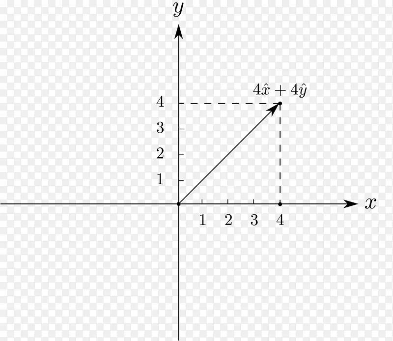

Let's move on to **Phase 2 — Vector Engine** for your C Machine Learning library (CML).

This is where your project starts becoming a real numerical computing library. Vectors are fundamental to machine learning: features, weights, gradients, predictions, embeddings, and many more concepts rely on vector operations.

You'll implement this yourself. I'll give you the architecture, API requirements, mathematical definitions, edge cases, test cases, and hints—but not the implementation solutions.

# **Phase 2 — Vector Engine**



**Difficulty:** Intermediate

**Estimated time:** 1–2 weeks

**Prerequisites:** Phase 0 infrastructure, numerical foundations

## **Objective**

Build a reusable, dynamically allocated vector abstraction supporting:

- Vector creation and destruction
- Element access and mutation
- Vector copying
- Arithmetic operations
- Dot product
- Norms
- Normalization
- Statistics
- Validation
- Error handling

By the end, you should be able to use your own CML vector engine to perform the numerical operations that underpin linear regression and neural networks.

# **1. Project structure**

Expand your library:

```
cml/
├── include/
│   └── cml/
│       ├── memory.h
│       ├── error.h
│       ├── math.h
│       └── vector.h
├── src/
│   ├── memory.c
│   ├── error.c
│   ├── math.c
│   └── vector.c
├── tests/
│   ├── test_memory.c
│   ├── test_error.c
│   └── test_vector.c
├── examples/
│   └── vector_example.c
├── Makefile
└── README.md
```

# **2. Vector data structure**

Design a public vector structure.

A vector should contain at least:

- Pointer to its numerical data
- Number of elements
- Capacity (optional, but recommended if you want dynamic resizing)

Your initial vectors should support `double` precision.

For example, mathematically:

$$
  \\mathbf{v} = \begin{bmatrix} 1.0\\\ 2.0\\\ 3.0\\\ 4.0 \end{bmatrix} \\
$$

Represent this in your library using a dynamically allocated array.

### **Your task**

Design the `CMLVector` structure.

Consider:

- Should users be allowed to access the internal data directly?
- Should the vector own its memory?
- Should capacity be separate from length?
- How will you represent an empty vector?
- What happens when allocation fails?

For version 1, I recommend **owning contiguous memory** with a `double *data` field.

# **3. Vector lifecycle**

Implement the fundamental lifecycle operations.

### **Required functions**

| Function   | Responsibility                                         |
| ---------- | ------------------------------------------------------ |
| Create     | Allocate a new vector                                  |
| Initialize | Create vector with a specified initial value           |
| Destroy    | Release vector resources                               |
| Clone      | Create an independent copy                             |
| Resize     | Change vector length                                   |
| Clear      | Reset vector contents or length, according to your API |

### **Requirements**

- No memory leaks.
- Correct handling of zero-length vectors.
- Allocation overflow protection.

- No use-after-free.
- Destruction must be safe according to your documented API contract.

### **Test cases**

- Create a vector with 0 elements.
- Create a vector with 1 element.
- Create a vector with 100 elements.
- Create a vector with a very large size.
- Initialize every element to a specified value.
- Destroy a vector.
- Clone a vector and modify the clone without affecting the original.
- Resize smaller.
- Resize larger.
- Resize to zero.
- Verify data preservation when resizing.

# **4. Element access**

Implement:

- Get element
- Set element
- Access raw data (optional)
- Fill vector
- Swap elements

### **Requirements**

- Validate indexes.
- Handle invalid arguments.
- Avoid undefined behavior.
- Decide how errors are reported.

### **Test cases**

For a vector:

$$
    \mathbf{v} = [10,20,30,40,50]
$$

Verify:

- Element 0 = 10
- Element 2 = 30
- Element 4 = 50
- Element 5 is out of bounds
- Setting element 2 to 99 works
- Filling the vector with 5 produces `[5,5,5,5,5]`
- Swapping positions 0 and 4 works
- Swapping an index with itself works

# **5. Arithmetic operations**

Implement vector arithmetic.

## **A. Addition**

$$
    \mathbf{c} = \mathbf{a}+\mathbf{b}
$$

Example:

$$
    [1,2,3]+[4,5,6]=[5,7,9]
$$

## **B. Subtraction**

$$
    \mathbf{c} = \mathbf{a}-\mathbf{b}
$$

Example:

$$
    [5,7,9]-[1,2,3]=[4,5,6]
$$

## **C. Element-wise multiplication**

$$
    \mathbf{c} = \mathbf{a}\odot\mathbf{b}
$$

Example:

$$
    [1,2,3]\odot[4,5,6]=[4,10,18]
$$

## **D. Element-wise division**

$$
    \mathbf{c} = \mathbf{a}\oslash\mathbf{b}
$$

Example:

$$
    [10,20,30]\oslash[2,4,5]=[5,5,6]
$$

Decide how your library handles division by zero.

## **E. Scalar multiplication**

$$
    \mathbf{c} = \alpha\mathbf{a}
$$

Example:

$$
    3[1,2,3]=[3,6,9]
$$

## **F. Scalar addition**

$$
    \mathbf{c}=\mathbf{a}+\alpha
$$

Example:

$$
    [1,2,3]+5=[6,7,8]
$$

## **G. Negation**

$$
    \mathbf{c}=-\mathbf{a}
$$

# **6. Advanced vector operations**

These are essential for machine learning and numerical algorithms.

## **A. Dot product**

$$
    \mathbf{a}\cdot\mathbf{b}=\sum\_{i=0}^{n-1}a_ib_i
$$

Example:

$$
    [1,2,3]\cdot[4,5,6]=32
$$

Implement a dot product function.

Test:

- Normal vectors.
- Negative values.
- Zero vectors.
- Large vectors.
- Different lengths.
- Overflow or non-finite results (consider how you want to handle them).

## **B. Magnitude (L2 norm)**

$ \left\| \vec{v} \right\|_2 = \sqrt{v_x^2 + v_y^2 + v_z^2} = \sqrt{\sum_{i=1}^{n-1} v_i^2} $

Example:

$$
    \\|[3,4]\|\\_2=5
$$

Implement vector magnitude.

## **C. L1 norm**

$$
    \\|\mathbf{v}\\|\_1=\sum\_{i=0}^{n-1}|v_i|
$$

Example:

$$
    \\|[-3,4,-2]\\|\_1=9
$$

## **D. Infinity norm**

$$
    \\|\mathbf{v}\\|\_\infty=\max_i|v_i|
$$

Example:

$$
    \\|[-3,4,-2]\\|\_\infty=4
$$

## **E. Normalize**

Create a unit vector:

$$
    \hat{\mathbf{v}}=\frac{\mathbf{v}}{\\|\mathbf{v}\\|\_2}
$$

For:

$$
    \mathbf{v}=[3,4]
$$

The result is:

$$
    \hat{\mathbf{v}}=[0.6,0.8]
$$

Its magnitude should equal 1 (within floating-point tolerance).

Consider how you handle a zero vector, since dividing by zero is mathematically undefined.

# **7. Statistics operations**

Implement the following vector statistics.

| Function           | Formula                   |
| ------------------ | ------------------------- |
| Sum                | \\(\sum x_i\\)            |
| Mean               | \\(\frac{1}{n}\sum x_i\\) |
| Minimum            | \\(\min(x_i)\\)           |
| Maximum            | \\(\max(x_i)\\)           |
| Variance           | Average squared deviation |
| Standard deviation | Square root of variance   |

For variance, support both:

### **Population variance**

$$
    \sigma^2=\frac{1}{n}\sum\_{i=1}^{n}(x_i-\mu)^2
$$

### **Sample variance**

$ s^2=\frac{1}{n-1}\sum\_{i=1}^{n}(x_i-\bar{x})^2 $

You must decide how to expose the distinction in your API.

### **Test vector**

```
[2, 4, 6, 8, 10]
```

Expected:

| Metric                        | Result          |
| ----------------------------- | --------------- |
| Sum                           | 30              |
| Mean                          | 6               |
| Min                           | 2               |
| Max                           | 10              |
| Population variance           | 8               |
| Population standard deviation | \\(\sqrt{8}\\)  |
| Sample variance               | 10              |
| Sample standard deviation     | \\(\sqrt{10}\\) |

# **8. In-place operations**

A performant library should avoid unnecessary allocations.

In addition to functions that return new vectors, implement in-place versions of selected operations.

For example, conceptually:

```
a = [1, 2, 3]
b = [4, 5, 6]

a += b

a = [5, 7, 9]
```

Implement in-place versions of:

- Addition
- Subtraction
- Element-wise multiplication
- Scalar multiplication
- Scalar addition
- Fill
- Normalize

### **Important design consideration**

Consider whether the following should be valid:

```
vector_add(a, b, a)
```

In other words, the output vector is also one of the input vectors.

This is called **aliasing**.

Your operations should either:

1. Safely support aliasing, or
2. Explicitly prohibit it and document the restriction.

Supporting aliasing is generally more convenient.

# **9. API design**

Design your public API in `include/cml/vector.h`.

I recommend separating operations into three categories:

### **Lifecycle**

- `cml_vector_create`
- `cml_vector_create_filled`
- `cml_vector_clone`
- `cml_vector_resize`
- `cml_vector_clear`
- `cml_vector_destroy`

### **Element operations**

- `cml_vector_get`
- `cml_vector_set`
- `cml_vector_fill`
- `cml_vector_swap`

### **Arithmetic and mathematical operations**

- `cml_vector_add`
- `cml_vector_sub`
- `cml_vector_mul`
- `cml_vector_div`
- `cml_vector_scale`
- `cml_vector_add_scalar`
- `cml_vector_negate`
- `cml_vector_dot`
- `cml_vector_norm`
- `cml_vector_normalize`

### **Statistics**

- `cml_vector_sum`
- `cml_vector_mean`
- `cml_vector_min`
- `cml_vector_max`
- `cml_vector_variance`
- `cml_vector_stddev`

These are naming suggestions. You can choose your own API, but keep naming consistent throughout CML.

## **API design decisions you must make**

1. Should each function return `CMLStatus`?
2. How should results be returned: output parameters or return values?
3. Should arithmetic allocate new vectors or modify existing vectors?
4. How do you prevent memory leaks when output allocation fails?
5. How do you handle vectors with different lengths?
6. What should happen when a vector is empty?
7. Should the vector struct be opaque or publicly exposed?
8. How do you handle `NaN` and infinity?
9. How do you handle division by zero?
10. How do you define ownership of vectors?

Think carefully about the API. Good design is often harder than implementing the arithmetic.

# **10. Numerical precision**

Since CML is a machine learning library, numerical correctness matters.

For testing floating-point results, **do not compare doubles using exact equality** for calculations.

Instead, use a tolerance:

$$
    |a-b|<\epsilon
$$

For example, your tests might use:

```
epsilon = 1e-9
```

However, consider whether one fixed tolerance is sufficient for all magnitudes.

Research and understand:

- Floating-point rounding
- Accumulation errors
- Catastrophic cancellation
- Overflow
- Underflow
- `NaN`
- Infinity
- `DBL_EPSILON`

You don't need to solve every numerical stability problem in this assignment, but you should understand why they exist.

# **11. Test suite**

Create `tests/test_vector.c`.

Organize your tests into groups.

**Test groups**

- Lifecycle tests
- Element access tests
- Arithmetic tests
- Dot product tests
- Norm tests
- Normalization tests
- Statistics tests
- In-place tests
- Error handling tests
- Edge-case tests

### **Minimum test coverage**

Your test suite should test:

- Create vector
- Create filled vector
- Clone vector
- Destroy vector
- Resize vector
- Clear vector
- Get and set elements
- Out-of-bounds access
- Fill
- Swap
- Addition
- Subtraction
- Multiplication
- Division
- Division by zero
- Scalar multiplication
- Scalar addition
- Negation
- Dot product
- L1 norm
- L2 norm
- Infinity norm
- Normalize
- Zero-vector normalization
- Sum
- Mean
- Min
- Max
- Population variance
- Sample variance
- Standard deviation
- Empty vector handling
- Mismatched vector dimensions
- Allocation failure handling
- Aliasing behavior

# **12. Example application**

Create:

```
examples/vector_example.c
```

Your example should demonstrate the library.

Use these two vectors:

$$
    \mathbf{a}=[1,2,3,4,5]
$$

$$
    \mathbf{b}=[10,20,30,40,50]
$$

Your program should:

1. Create both vectors.
2. Print their contents.
3. Add them.
4. Subtract them.
5. Calculate their dot product.
6. Calculate their magnitudes.
7. Normalize vector A.
8. Calculate the mean of A.
9. Calculate the variance of A.
10. Destroy all vectors.

Expected results:

| Operation                | Expected result    |
| ------------------------ | ------------------ |
| \\(a+b\\)                | `[11,22,33,44,55]` |
| \\(b-a\\)                | `[9,18,27,36,45]`  |
| \\(a\cdot b\\)           | 550                |
| \\(\\\|a\\\|\_2\\)       | \\(\sqrt{55}\\)    |
| \\(\\\|b\\\|\_2\\)       | \\(\sqrt{5500}\\)  |
| Mean of A                | 3                  |
| Population variance of A | 2                  |

# **13. Performance challenge**

Once all tests pass, improve your implementation.

Benchmark:

- Vector with 10 elements
- Vector with 1,000 elements
- Vector with 100,000 elements
- Vector with 1,000,000 elements

Measure:

- Creation
- Addition
- Dot product
- Normalization
- Clone
- Resize

Investigate:

- How many memory allocations each operation performs.
- Whether loops are cache-friendly.
- Whether you are unnecessarily copying vectors.
- Whether your implementation can take advantage of contiguous memory.
- Whether your compiler optimizes loops.

Don't prematurely optimize. First make it correct, then measure, then improve.

# **14. Build integration**

Update your Makefile to support the new vector module.

You should be able to run commands similar to:

```
make
make test
make test-vector
make example
make clean
```

Your test executable should compile using your existing modules:

```
cc -Wall -Wextra -Wpedantic -std=c11 \
    -I./include \
    src/memory.c \
    src/error.c \
    src/vector.c \
    tests/test_vector.c \
    -lm \
    -o test_vector
```

The `-lm` flag is commonly needed on macOS/Linux for mathematical functions such as `sqrt`, depending on your compiler/linker.

Run your tests:

```
./test_vector
```

Use sanitizers where available:

```
cc -Wall -Wextra -Wpedantic -std=c11 \
    -fsanitize=address,undefined \
    -g -I./include \
    src/memory.c \
    src/error.c \
    src/vector.c \
    tests/test_vector.c \
    -lm \
    -o test_vector
```

# **15. Evaluation rubric**

I'll review your work using this rubric:

| Category                            | Points  |
| ----------------------------------- | ------- |
| Data structure & lifecycle          | 15      |
| Memory safety                       | 15      |
| Element access                      | 10      |
| Arithmetic operations               | 15      |
| Mathematical operations & norms     | 15      |
| Statistics                          | 10      |
| Error handling & edge cases         | 10      |
| Tests, documentation & code quality | 10      |
| **Total**                           | **100** |

## **Completion milestones**

You don't have to implement everything in one sitting. Work in this order:

1. **Milestone 1 — Vector structure**
2. **Milestone 2 — Lifecycle and memory management**
3. **Milestone 3 — Element access and mutation**
4. **Milestone 4 — Basic arithmetic**
5. **Milestone 5 — Dot product and norms**
6. **Milestone 6 — Statistics**
7. **Milestone 7 — In-place operations**
8. **Milestone 8 — Comprehensive tests and optimization**

**You can submit each milestone for review before proceeding.** I'll help you identify bugs, memory safety problems, mathematical mistakes, API design flaws, and opportunities to improve your C skills without taking away the learning experience by giving you the solution immediately.

### **What comes after Phase 2?**

Your next major phase will be:

**Phase 3 — Matrix Engine**

You'll build two-dimensional numerical data structures, matrix multiplication, transpose, row/column operations, and the foundation for solving linear algebra problems.

Eventually, your vector and matrix engines will power your own implementations of linear regression, logistic regression, neural networks, backpropagation, and optimizers.

Start with **Milestone 1: design the&#x20;**`CMLVector`**&#x20;struct and your&#x20;**`vector.h`**&#x20;API**. Send me your design first, and I'll review the architecture before you write the implementation.
