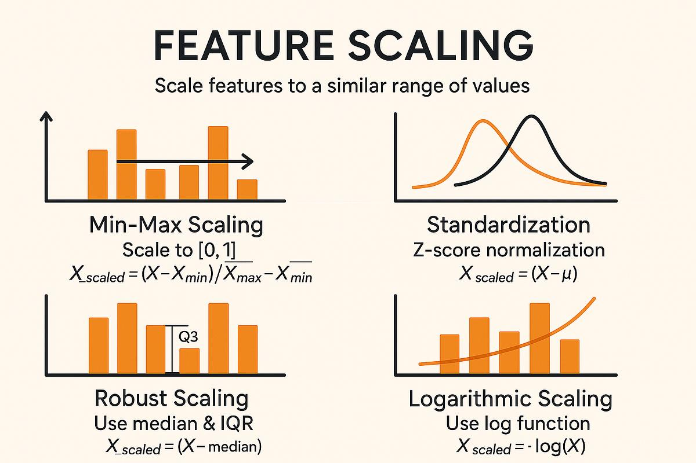
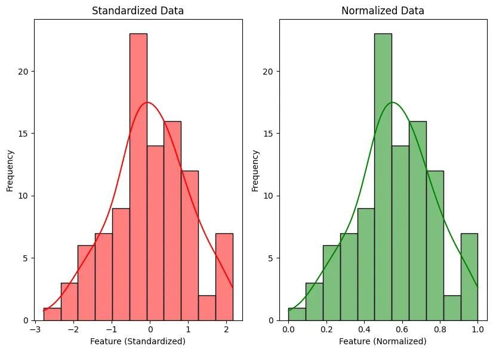
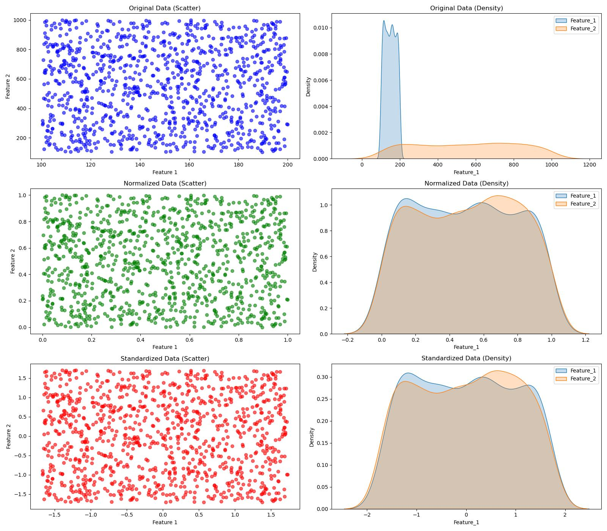

# **Phase 4 — Statistics & Data Processing**

Now we're moving from building mathematical primitives to building the tools that actually prepare data for machine learning.

This phase is critical. In real machine learning, raw data is rarely ready to feed directly into a model. You need to clean it, transform it, normalize it, detect anomalies, split datasets, and understand its statistical properties.

Your CML library will now begin developing capabilities similar to the data-processing foundations found in NumPy, pandas, and scikit-learn.





10

**Difficulty:** Intermediate → Advanced

**Estimated time:** 2–4 weeks

**Prerequisites:** Phase 0 infrastructure, Phase 2 vector engine, Phase 3 matrix engine

## **Objective**

Build a data-processing and statistical analysis module that can:

- Calculate descriptive statistics
- Analyze vectors and matrix columns
- Normalize data
- Standardize features
- Detect missing and invalid values
- Handle outliers
- Split datasets into training, validation, and test sets
- Shuffle data
- Build reusable datasets
- Calculate correlations
- Prepare data for regression and classification

By the end, you'll be able to take raw numerical data and prepare it for your future ML algorithms.

# **1. Project structure**

Extend CML:

```
cml/
├── include/
│   └── cml/
│       ├── memory.h
│       ├── error.h
│        ├── math.h
│       ├── vector.h
│       ├── matrix.h
│       ├── statistics.h
│       ├── preprocessing.h
│       └── dataset.h
├── src/
│   ├── memory.c
│   ├── error.c
│   ├── math.c
│   ├── vector.c
│   ├── matrix.c
│   ├── statistics.c
│   ├── preprocessing.c
│   └── dataset.c
├── tests/
│   ├── test_memory.c
│   ├── test_error.c
│   ├── test_vector.c
│   ├── test_matrix.c
│   ├── test_statistics.c
│   ├── test_preprocessing.c
│   └── test_dataset.c
├── examples/
│   ├── vector_example.c
│   ├── matrix_example.c
│   └── data_analysis_example.c
├── benchmarks/
├── Makefile
└── README.md
```

You will create three modules:

1. `statistics`
2. `preprocessing`
3. `dataset`

We will implement them progressively.

# **2. Assignment 01 — Descriptive Statistics**

First, create a statistical engine for vectors and matrices.

## **A. Basic statistics**

Implement these calculations:

| Metric             | Mathematical definition            |
| ------------------ | ---------------------------------- |
| Sum                | $\\\sum x_i\\$                     |
| Mean               | $\\\frac{1}{n}\sum x_i\\$          |
| Median             | Middle value after sorting         |
| Minimum            | Smallest value                     |
| Maximum            | Largest value                      |
| Range              | Max − min                          |
| Variance           | Average squared deviation          |
| Standard deviation | Square root of variance            |
| Percentile         | Value below a specified proportion |
| Quartiles          | 25%, 50%, 75% percentiles          |

Some of these may already exist in your vector engine. You should decide whether to:

- Reuse existing functions
- Move them into the statistics module
- Keep vector convenience functions that call the statistics module

Avoid duplicating implementations.

## **B. Mean**

For:

$X=[2,4,6,8,10]$

$mu=\frac{2+4+6+8+10}{5}=6$

Implement:

- Mean of vector
- Mean of matrix
- Mean of a matrix row
- Mean of a matrix column

### **Test cases**

```
[2, 4, 6, 8, 10] → 6
[5, 5, 5, 5]     → 5
[-2, 0, 2]        → 0
[1]               → 1
```

Consider:

- Empty input
- NaN
- Infinity
- Very large values
- Floating-point accumulation error

## **C. Median**

The median is the middle value of sorted data.

For odd-length data:

$[1,3,5,7,9]$

Median:

$5$

For even-length data:

$[1,3,5,7]$

Median:

$\frac{3+5}{2}=4$

Your implementation should not modify the original vector unless explicitly requested.

### **Requirements**

- Handle odd and even lengths.
- Handle unsorted input.
- Define empty-vector behavior.
- Handle duplicate values.
- Consider NaN handling.
- Decide whether to use a full sort or a selection algorithm.

### **Hint**

A simple implementation using a copied array and sorting is acceptable for your first version.

Later, research selection algorithms such as Quickselect.

## **D. Variance and standard deviation**

Implement population and sample variance.

### **Population variance**

$\sigma^2=\frac{1}{n}\sum\_{i=1}^{n}(x_i-\mu)^2$

### **Sample variance**

$s^2=\frac{1}{n-1}\sum\_{i=1}^{n}(x_i-\bar{x})^2$

### **Important numerical challenge**

The straightforward formula may suffer from numerical instability when numbers are large but differences are small.

Research:

- Two-pass variance
- Welford's online algorithm

Your assignment:

1. Implement a basic correct variance calculation.
2. Test it against known results.
3. Investigate Welford's algorithm.
4. Implement a numerically stable version as a bonus.

## **E. Percentiles and quartiles**

Implement percentile calculation.

A percentile answers:

> What value is at or below a given percentage of the data?

For example, the 90th percentile represents a threshold below which approximately 90% of observations fall, depending on the chosen percentile convention.

### **Requirements**

- Accept a percentile between 0 and 100, or a quantile between 0 and 1.
- Handle unsorted input.
- Define your interpolation method.
- Handle empty input.
- Handle percentile 0 and percentile 100.
- Avoid modifying the original data.

Research different percentile conventions. Statistical libraries can produce slightly different answers depending on their method.

**Document your chosen convention.**

# **3. Assignment 02 — Feature Scaling & Normalization**

This is one of the most important preprocessing operations in ML.

Suppose your dataset contains:

| Age | Salary  |
| --- | ------- |
| 20  | 15,000  |
| 30  | 30,000  |
| 40  | 60,000  |
| 50  | 120,000 |

Salary has a much larger numerical scale than age.

Many machine learning algorithms are sensitive to differences in feature scale.

You will implement several transformations.

## **A. Min-Max normalization**

Transform data into a specified range, typically `[0, 1]`.

Formula:

$x'=\frac{x-x\_{\min}}{x\_{\max}-x\_{\min}}$

Example:

$X=[10,20,30,40,50]$

Results:

$X'=[0,0.25,0.5,0.75,1]$

### **Requirements**

Implement:

- Vector min-max normalization
- Matrix column-wise normalization
- Custom target range
- In-place and non-in-place variants

Allow target ranges such as:

$[-1,1]$

### **Edge cases**

- Constant vector
- Empty vector
- Target minimum equals target maximum
- NaN
- Infinity
- Extremely large or small values

For constant features, you must decide what the normalized output should be.

Possible approaches:

- Output zeros.
- Output the midpoint of the target range.
- Return a numerical error.
- Preserve the original values.

Choose one policy and document it.

## **B. Z-score standardization**

Transform data to have approximately zero mean and unit standard deviation.

$z=\frac{x-\mu}{\sigma}$

Example:

$X=[2,4,6,8,10]$

Population mean:

$\mu=6$

Population standard deviation:

$\sigma=\sqrt{8}$

The standardized values are:

$[-1.4142,-0.7071,0,0.7071,1.4142]$

### **Requirements**

Implement:

- Vector standardization
- Matrix column-wise standardization
- In-place and non-in-place versions
- Population standard deviation mode
- Optional sample standard deviation mode

### **Test cases**

- Standardize `[2,4,6,8,10]`.
- Verify resulting mean approximately equals zero.
- Verify resulting population standard deviation approximately equals one.
- Standardize constant vector.
- Standardize vector with one element.
- Standardize empty vector.

## **C. Robust scaling**

Robust scaling uses the median and interquartile range.

$x'=\frac{x-\operatorname{median}(X)}{Q_3-Q_1}$

Where:

$IQR=Q_3-Q_1$

This is less sensitive to extreme outliers than mean/std scaling.

Example:

```
[1, 2, 3, 4, 5, 1000]
```

The extreme value `1000` can heavily affect standardization but has less influence on the median and IQR.

Implement:

- Median centering
- IQR scaling
- Matrix column-wise robust scaling

Handle zero IQR.

# **4. Assignment 03 — Missing Data & Invalid Values**

Real-world data is messy.

You will need to recognize:

- NaN
- Infinity
- Missing values
- Invalid numeric values
- Duplicate data
- Constant features

In C, you can use facilities from `<math.h>`:

- `isnan`
- `isinf`
- `isfinite`

## **A. Detect invalid values**

Implement:

- Count NaN values
- Count infinite values
- Count non-finite values
- Check whether a vector is entirely finite
- Check whether a matrix is entirely finite
- Find indexes of invalid values

### **Test dataset**

```
[1.0, 2.0, NAN, 4.0, INFINITY, 6.0]
```

Expected:

- NaN count = 1
- Infinite count = 1
- Non-finite count = 2
- Finite = false

## **B. Missing-value handling**

Implement strategies to handle invalid or missing values.

### **Strategy 1 — Remove**

Remove elements containing invalid values.

For:

```
[1, 2, NAN, 4, INFINITY, 6]
```

Result:

```
[1, 2, 4, 6]
```

### **Strategy 2 — Replace with constant**

Replace invalid values with a user-defined constant.

Example:

```
[1, 2, NAN, 4]
```

Replace NaN with zero:

```
[1, 2, 0, 4]
```

### **Strategy 3 — Mean imputation**

Replace missing values with the mean of valid observations.

Example:

```
[2, 4, NAN, 8]
```

Valid mean:

$\frac{2+4+8}{3}=\frac{14}{3}$

Result:

```
[2, 4, 4.6667, 8]
```

### **Strategy 4 — Median imputation**

Replace invalid values with the median of valid values.

This is more robust when the dataset contains outliers.

### **Matrix requirements**

Support column-wise imputation.

Example:

$\begin{bmatrix}1&10\\\3&\mathrm{NaN}\\\5&30\\\7&40\end{bmatrix}$

Replace the missing value using the mean of column 1.

Don't accidentally calculate a global mean across all features.

# **5. Assignment 04 — Outlier Detection**

Outliers are observations significantly different from the rest of the dataset.

Example:

```
[10, 11, 12, 13, 14, 15, 1000]
```

The value `1000` may be an outlier.

Implement two detection techniques.

## **A. IQR method**

Calculate:

$IQR=Q_3-Q_1$

Lower bound:

$L=Q_1-1.5(IQR)$

Upper bound:

$U=Q_3+1.5(IQR)$

Any observation outside the bounds is flagged.

Requirements:

- Detect outliers.
- Return indexes.
- Return lower and upper bounds.
- Support matrix columns.
- Allow configurable multiplier (e.g. 1.5 or 3.0).

## **B. Z-score method**

$z=\frac{x-\mu}{\sigma}$

Flag observations when:

$|z|>t$

Where `t` is a configurable threshold, commonly 3.

Requirements:

- Return a mask indicating outliers.
- Support vector and matrix data.
- Handle constant features.
- Handle non-finite values.

## **C. Outlier handling**

Implement optional strategies:

- Remove outliers.
- Clamp values to lower and upper bounds (winsorization).
- Replace outliers with median.

Don't automatically remove outliers. Your library should let the user choose.

# **6. Assignment 05 — Dataset Management**

Now you'll create a higher-level abstraction for machine learning datasets.

A dataset typically contains:

- Features (`X`)
- Targets/labels (`y`)
- Sample count
- Feature count
- Optional feature names
- Optional target names

For example, a house-price dataset:

Example dataset

| Size (sqft) | Bedrooms | Price ($) |
| ----------- | -------- | --------- |
| 850         | 2        | 150,000   |
| 1200        | 3        | 220,000   |
| 1600        | 3        | 300,000   |
| 2100        | 4        | 420,000   |

Features:

$X= \begin{bmatrix} 850&2\\\ 1200&3\\\ 1600&3\\\ 2100&4 \end{bmatrix}$

Targets:

$y= \begin{bmatrix} 150000\\\ 220000\\\ 300000\\\ 420000 \end{bmatrix}$

## **Your task**

Design a `CMLDataset` structure.

Consider:

- Owning versus borrowing matrix/vector memory
- Features and targets
- Dataset size
- Feature names
- Target names
- Data types
- Memory management

### **Required operations**

- Create dataset
- Destroy dataset
- Get sample count
- Get feature count
- Get feature row
- Get target
- Set sample
- Clone dataset
- Shuffle dataset
- Validate dataset dimensions

# **7. Assignment 06 — Dataset Splitting**

Machine learning models must be evaluated on data they haven't trained on.

Implement dataset splitting.

## **A. Train/test split**

Typical split:

- 80% training
- 20% testing

Or:

- 70% training
- 15% validation
- 15% testing

Implement configurable proportions.

For example:

```
Dataset: 1000 samples

Training:   800
Validation: 100
Testing:    100
```

Requirements:

- User-defined proportions.
- Proportions must be validated.
- All subsets must be disjoint.
- All samples must be accounted for.
- Shuffle before splitting (optional setting).
- Preserve feature-target alignment.

## **B. Random seed**

The user should be able to specify a seed.

Example:

```
seed = 42
```

The same seed should produce the same split.

This is essential for reproducibility.

Don't rely blindly on global `rand()` state. Investigate how to design a reproducible random-number generator interface for CML.

## **C. Stratified splitting (bonus)**

For classification datasets, preserve approximate class proportions.

For example:

```
Original:
Class A = 80%
Class B = 20%

Training:
Class A ≈ 80%
Class B ≈ 20%

Testing:
Class A ≈ 80%
Class B ≈ 20%
```

This becomes especially useful when classes are imbalanced.

# **8. Assignment 07 — Shuffling**

Implement a proper random shuffle for:

- Vectors
- Matrix rows
- Datasets

The dataset shuffle must keep features and targets together.

For example, if sample 5 moves to position 2, its target must move with it.

## **Requirements**

- Reproducible seed.
- Uniform shuffle.
- In-place option.
- Non-in-place option.
- No sample duplication.
- No sample loss.
- Features and targets remain aligned.

### **Hint**

Research the Fisher–Yates shuffle algorithm.

Do not simply swap each element with a random index across the entire array. That method can produce biased permutations.

# **9. Assignment 08 — Correlation & Covariance**

Now we'll implement statistics that help identify relationships between features.

## **A. Covariance**

Covariance measures how two variables change together.

$\operatorname{Cov}(X,Y)= \frac{1}{n-1} \sum\_{i=1}^{n}(x_i-\bar{x})(y_i-\bar{y})$

Implement:

- Sample covariance
- Population covariance
- Covariance between two vectors
- Covariance matrix for a dataset

### **Test**

```
X = [1, 2, 3, 4, 5]
Y = [2, 4, 6, 8, 10]
```

The variables have a perfect positive linear relationship.

Calculate covariance and verify it against your expected result.

## **B. Pearson correlation**

Pearson correlation measures the strength and direction of linear relationships.

$r=\frac{\operatorname{Cov}(X,Y)}{\sigma_X\sigma_Y}$

The result is between -1 and 1.

| Correlation | Meaning                              |
| ----------- | ------------------------------------ |
| +1          | Perfect positive linear relationship |
| 0           | No linear correlation                |
| -1          | Perfect negative linear relationship |

### **Tests**

Perfect positive correlation:

```
X = [1, 2, 3, 4, 5]
Y = [2, 4, 6, 8, 10]
```

Expected:

$r=1$

Perfect negative correlation:

```
X = [1, 2, 3, 4, 5]
Y = [10, 8, 6, 4, 2]
```

Expected:

$r=-1$

No linear correlation:

```
X = [-2, -1, 0, 1, 2]
Y = [1, -2, 2, -1, 0]
```

Expected approximately zero.

### **Requirements**

- Handle constant vectors.
- Handle empty input.
- Handle different lengths.
- Handle NaN.
- Avoid division by zero.
- Use tolerance when testing.

## **C. Correlation matrix**

For a dataset with several features, calculate pairwise correlation.

Example:

$X= \begin{bmatrix} 1&2&10\\\ 2&4&20\\\ 3&6&30\\\ 4&8&40 \end{bmatrix}$

The correlation matrix should have:

- Ones on the diagonal.
- Symmetry.
- Values between -1 and 1 (within numerical tolerance).

This will help later with feature analysis and understanding redundant features.

# **10. Assignment 09 — Feature Transformations**

This assignment introduces transformations used in real ML preprocessing pipelines.

## **A. Log transformation**

Implement:

$x'=\log(x)$

Optionally support:

$x'=\log(1+x)$

The second form is often useful when the dataset contains zeros.

Requirements:

- Vector and matrix operations.
- Column-wise transformation.
- Handle negative values.
- Handle zero.
- Handle non-finite values.

## **B. Power transformation (bonus)**

Implement a configurable power transform:

$x'=x^p$

Investigate how different powers affect data distributions.

## **C. Feature clipping**

Clamp values into a defined range:

$x'=\min(\max(x,L),U)$

Example:

```
Input:  [1, 5, 10, 100, 200]
Bounds: [0, 50]

Output: [1, 5, 10, 50, 50]
```

Implement:

- Vector clipping
- Matrix clipping
- Per-feature bounds (bonus)

# **11. Assignment 10 — Data Processing Pipeline**

Now combine your preprocessing functions into a reusable pipeline.

A pipeline might look conceptually like:

```
Raw Dataset
    ↓
Validate
    ↓
Handle Missing Values
    ↓
Remove / Handle Outliers
    ↓
Normalize Features
    ↓
Split Dataset
    ↓
Training Data
```

Design a preprocessing pipeline that can execute multiple transformations in sequence.

### **Requirements**

- Add preprocessing steps.
- Configure each step.
- Execute steps in order.
- Handle failures.
- Allow pipeline reuse.
- Track transformation configuration.
- Avoid unnecessary copies where possible.

### **Bonus**

Implement a pipeline that can be serialized and reconstructed later.

## **12. Critical machine learning concept — Data leakage**

One of the most important things you'll learn in this phase is **data leakage**.

Suppose you standardize your entire dataset before splitting it:

```
Full dataset
    ↓
Calculate mean and standard deviation
    ↓
Standardize everything
    ↓
Split into training and testing
```

This allows information from your test data to influence the transformation used during training.

The correct approach for transformations that learn parameters from data is:

```
Full dataset
    ↓
Split
    ├── Training data
    └── Testing data
            ↓
Fit scaler using training data ONLY
            ↓
Transform training data
            ↓
Transform testing data using training parameters
```

For example, your scaler should store:

```
mean
standard deviation
minimum
maximum
```

These parameters are calculated from the training data and then reused for validation and test data.

### **Your assignment**

Design a scaler object with two separate operations:

- `fit` — learns parameters from a dataset.
- `transform` — applies learned parameters to a dataset.

Optionally:

\- `fit_transform` — fits and transforms in one operation.

The scaler must not recalculate its parameters when transforming the test set.

This is a major architectural requirement for your CML preprocessing engine.

# **13. Assignment 11 — CSV Dataset Loader (Bonus)**

Machine learning data is commonly stored in CSV files.

Example:

```
age,income,experience,salary
25,30000,2,40000
30,50000,5,65000
35,70000,8,90000
40,90000,12,120000
```

Build a CSV loader that converts this into a CML dataset.

### **Requirements**

- Read a CSV file.
- Parse numerical values.
- Handle headers.
- Validate column counts.
- Handle malformed rows.
- Detect invalid numeric values.
- Handle empty files.
- Handle missing fields.
- Support configurable target columns.
- Report parsing errors with line numbers.

### **Bonus**

- Feature names.
- String categorical features.
- CSV export.
- Streaming parser for large files.

Be careful: CSV parsing is more complicated than splitting on commas. Quoted fields can contain commas, escaped quotes, and newlines. You may begin with a clearly documented restricted CSV format and expand it later.

# **14. Capstone — Complete Data Analysis Workflow**

Create:

```
examples/data_analysis_example.c
```

Your program should demonstrate your entire Phase 4 library.

Use a dataset similar to:

| Size | Bedrooms | Age | Price  |
| ---- | -------- | --- | ------ |
| 850  | 2        | 10  | 150000 |
| 1200 | 3        | 8   | 220000 |
| 1600 | 3        | 5   | 300000 |
| 2100 | 4        | 3   | 420000 |
| 2500 | 4        | 2   | 500000 |
| 3000 | 5        | 1   | 600000 |
| 1100 | 2        | 15  | 180000 |
| 1800 | 3        | 7   | 340000 |
| 2200 | 4        | 6   | 450000 |
| 3500 | 5        | 2   | 750000 |

Your workflow should:

1. Create the dataset.
2. Validate dimensions.
3. Calculate feature statistics.
4. Calculate target statistics.
5. Detect invalid values.
6. Detect outliers.
7. Shuffle the dataset reproducibly.
8. Split into training and testing.
9. Fit a scaler on training features.
10. Transform training features.
11. Transform testing features using the same scaler.
12. Calculate correlations.
13. Print a summary report.
14. Clean up all memory.

Example report:

```
========================================
          CML DATA ANALYSIS
========================================

Samples:       10
Features:      3
Target:        Price

FEATURE STATISTICS
----------------------------------------
Size
  Mean:        1,985.00
  Median:      1,900.00
  Min:           850.00
  Max:         3,500.00
  Std Dev:       ...

Bedrooms
  Mean:          3.50
  Min:           2.00
  Max:           5.00

DATA QUALITY
----------------------------------------
Missing values:       0
Non-finite values:    0
Outliers detected:    ...

DATA SPLIT
----------------------------------------
Training:       8 samples
Testing:        2 samples

PREPROCESSING
----------------------------------------
Scaler:         Standardization
Fitted on:      Training set only
Status:         Complete

========================================
```

Your report doesn't have to match exactly. The goal is to build a working workflow using your own library functions.

# **15. Testing requirements**

Create dedicated tests for each module.

### `test_statistics.c`

- Mean
- Median
- Variance
- Standard deviation
- Min/max
- Range
- Percentile
- Quartiles
- Empty data
- Single element
- NaN
- Infinity

### `test_preprocessing.c`

- Min-max normalization
- Z-score standardization
- Robust scaling
- Constant features
- Missing-value replacement
- Missing-value removal
- Outlier detection
- Clipping
- Log transformation
- Invalid ranges

### `test_dataset.c`

- Dataset creation
- Dataset cloning
- Dataset destruction
- Sample extraction
- Feature extraction
- Dataset validation
- Shuffling
- Train/test splitting
- Reproducibility
- Feature-target alignment
- Empty dataset
- Invalid dimensions

### `test_pipeline.c`

- Add steps
- Execute pipeline
- Fit scaler
- Transform data
- Reuse fitted scaler
- Pipeline failure handling
- Data leakage prevention

# **16. Performance and engineering requirements**

As your library becomes larger, the quality of its architecture matters.

Your implementation should:

- Reuse vector and matrix functions where appropriate.
- Minimize unnecessary allocations.
- Avoid copying large datasets repeatedly.
- Check allocation-size overflow.
- Avoid global mutable state where possible.
- Use your existing error system consistently.
- Document ownership of every allocated object.
- Avoid silently modifying inputs.
- Make random operations reproducible.
- Use numerical tolerances in tests.
- Compile cleanly with warnings enabled.

Recommended compilation:

```
cc -Wall -Wextra -Wpedantic -Wconversion -Wshadow \
    -std=c11 -I./include \
    src/*.c tests/test_statistics.c \
    -lm -o test_statistics
```

If wildcard compilation starts including multiple test files with their own `main()` functions, adjust the build command to include only the intended test file and required source files.

Use sanitizers:

```
cc -Wall -Wextra -Wpedantic -std=c11 \
    -fsanitize=address,undefined \
    -g -I./include \
    src/memory.c \
    src/error.c \
    src/vector.c \
    src/matrix.c \
    src/statistics.c \
    src/preprocessing.c \
    src/dataset.c \
    tests/test_dataset.c \
    -lm -o test_dataset
```

# **17. Phase 4 grading rubric**

| Category                               | Points  |
| -------------------------------------- | ------- |
| Descriptive statistics                 | 15      |
| Normalization & scaling                | 15      |
| Missing-value handling                 | 10      |
| Outlier detection                      | 10      |
| Dataset architecture                   | 15      |
| Shuffling & splitting                  | 10      |
| Covariance & correlation               | 10      |
| Pipeline & leakage prevention          | 5       |
| Testing, memory safety & documentation | 10      |
| **Total**                              | **100** |

# **18. Milestones**

Don't attempt to build all of Phase 4 at once. Work through these milestones.

1. **Milestone 1 — Descriptive statistics**
2. **Milestone 2 — Percentiles and quartiles**
3. **Milestone 3 — Normalization and standardization**
4. **Milestone 4 — Missing values**
5. **Milestone 5 — Outlier detection**
6. **Milestone 6 — Dataset structure**
7. **Milestone 7 — Shuffling and splitting**
8. **Milestone 8 — Covariance and correlation**
9. **Milestone 9 — Feature transformations**
10. **Milestone 10 — Pipeline and data leakage prevention**
11. **Milestone 11 — CSV loading and capstone**

## **Start here: Milestone 1**

Your first assignment is to implement **Descriptive Statistics**.

Start by designing:

1. `statistics.h`
2. Your statistical API.
3. The function signatures for mean, median, variance, standard deviation, min, max, sum, and range.
4. Decide how statistics functions report errors.
5. Decide how empty vectors are handled.
6. Decide how NaN and infinity affect calculations.

Then implement **mean, sum, min, max, and range first**. Leave median and variance for the next step.

Send me your `statistics.h` and implementation when you're ready. I'll review your API and code, test the mathematical correctness, identify edge cases, and grade your milestone before you proceed.

### **Your CML roadmap so far**

**Phase 0 — C infrastructure**

Memory, error handling, logging, project setup

**Phase 1 — Numerical foundations**

Basic mathematics and numerical computing fundamentals

**Phase 2 — Vector engine**

Dynamic vectors, arithmetic, norms, and statistics

**Phase 3 — Matrix engine**

Matrix operations, multiplication, transpose, linear algebra

**Phase 4 — Statistics & data processing**

Data cleaning, scaling, datasets, splitting, correlations

You're building these foundational components before jumping into ML algorithms—and that's the right approach. By the time you reach linear regression, you'll understand exactly what's happening underneath instead of depending on libraries to do the math for you.

The next major phase after this is **Phase 5 — Linear Regression from Scratch**, where your library will finally start training its first machine learning model. 🚀
