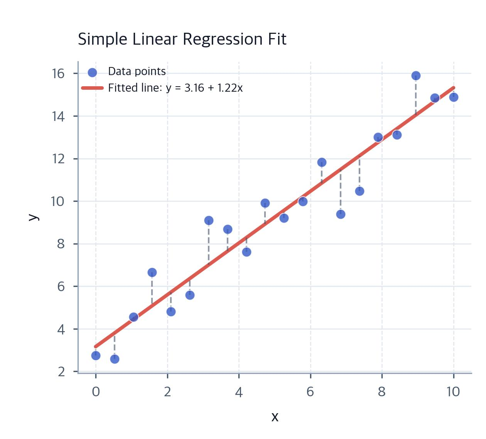

# **Phase 5 — Linear Regression from Scratch**

This is where your C Machine Learning library (CML) officially begins implementing its first machine learning model.

You've been building the infrastructure:

- Memory management
- Error handling
- Vectors
- Matrices
- Statistics
- Data preprocessing
- Dataset management

Now you're going to use those components to build a model that **learns relationships from data and makes predictions**.

You will implement linear regression entirely in C, without using machine learning libraries.



**Difficulty:** Intermediate → Advanced

**Estimated time:** 2–4 weeks

**Prerequisites:** Vector, matrix, statistics, and dataset modules

## **Objective**

Build a complete linear regression module supporting:

- Simple linear regression
- Multiple linear regression
- Model initialization
- Training
- Prediction
- Loss calculation
- Model evaluation
- Coefficient estimation
- Intercept handling
- Training data validation
- Model persistence (bonus)

You'll implement two approaches:

1. **Closed-form solution** — calculates coefficients mathematically.
2. **Gradient descent** — learns coefficients iteratively.

This will help you understand both the mathematical solution and how modern ML models learn.

# **1. Project structure**

Add your regression module:

```
cml/
├── include/
┃   └── cml/
┃       ├── memory.h
┃       ├── error.h
┃       ├── vector.h
┃        ├── matrix.h
┃       ├── statistics.h
┃       ├── preprocessing.h
┃       ├── dataset.h
┃       └── linear_regression.h
├── src/
┃   ├── memory.c
┃   ├── error.c
┃   ├── vector.c
┃   ├── matrix.c
┃   ├── statistics.c
┃   ├── preprocessing.c
┃   ├── dataset.c
┃   └── linear_regression.c
├── tests/
┃   ├── test_memory.c
┃   ├── test_vector.c
┃   ├── test_matrix.c
┃   ├── test_statistics.c
┃   ├── test_preprocessing.c
┃   ├── test_dataset.c
┃   └── test_linear_regression.c
├── examples/
┃   └── linear_regression_example.c
├── Makefile
└── README.md
```

# **2. Understand the model**

Linear regression predicts a continuous value using a linear relationship between input features and output.

## **Simple linear regression**

With one feature:

$ \boxed{y=wx+b} $

Where:

$ \\x\ $ = input feature
$ \\w\ $ = weight / slope
$ \\b\ $ = bias / intercept
$ \\y\ $ = prediction

Example: predicting house price based on size.

$ \text{Price}=150(\text{Size})+20000 $

For a house with 1,000 square feet:

$ \hat{y}=150(1000)+20000 $

$ \hat{y}=170000 $

Your model should learn the values of \\(w\\) and \\(b\\) from data.

# **3. Assignment 01 — Model architecture**

Design a `CMLLinearRegression` model.

Your model should store:

- Model coefficients (weights)
- Intercept / bias
- Number of features
- Whether the model has been trained
- Configuration settings
- Training metadata (optional)

For multiple features:

$ \hat{y}=w_1x_1+w_2x_2+\cdots+w_nx_n+b $

Example:

$ \hat{y}=3x_1+5x_2+2x_3+10 $

If:

$ \mathbf{x}=[2,4,6] $

Then:

$ \hat{y}=3(2)+5(4)+2(6)+10 $

$ \hat{y}=48 $

## **Your task**

Design the model structure.

Think about:

- Should weights be stored as `CMLVector`?
- Should bias be separate?
- Should the model own its weights?
- How do you represent an untrained model?
- How do you prevent predictions before training?
- How do you handle a feature count mismatch?
- Should the model have configuration options?
- How should model destruction work?

# **4. Assignment 02 — Simple Linear Regression**

Start with only one input feature.

Your dataset:

| X   | Y   |
| --- | --- |
| 1   | 3   |
| 2   | 5   |
| 3   | 7   |
| 4   | 9   |
| 5   | 11  |

The relationship is:

$ y=2x+1 $

Your model must learn:

$ w=2 $

$ b=1 $

## **Training objective**

Find the coefficients that minimize the prediction error.

Your model should:

1. Accept training inputs.
2. Accept target values.
3. Estimate the slope.
4. Estimate the intercept.
5. Store the learned parameters.
6. Mark itself as trained.

## **Test cases**

After training, predict:

| X   | Expected prediction |
| --- | ------------------- |
| 1   | 3                   |
| 2   | 5                   |
| 3   | 7                   |
| 4   | 9                   |
| 5   | 11                  |
| 10  | 21                  |
| 20  | 41                  |

The last two are important because they test predictions on inputs not used during training.

### **Requirements**

- Validate input dimensions.
- Validate target dimensions.
- Reject empty datasets.
- Handle constant input values.
- Handle non-finite inputs.
- Handle numerical errors.
- Avoid modifying training data.
- Support prediction before/after training according to your documented policy.

# **5. Assignment 03 — Closed-Form Solution**

This is your first approach to training a model.

For simple linear regression, you can calculate the optimal slope and intercept directly from the training data.

## **Slope**

$ w=\frac{\sum\_{i=1}^{n}(x_i-\bar{x})(y_i-\bar{y})}{\sum\_{i=1}^{n}(x_i-\bar{x})^2} $

## **Intercept**

$ b=\bar{y}-w\bar{x} $

Where:

- \\(\bar{x}\\) is the mean of the input values.
- \\(\bar{y}\\) is the mean of the target values.
- \\(n\\) is the number of training samples.

### **Your assignment**

Implement the closed-form estimator for simple linear regression.

You can reuse your existing statistics module.

### **Test datasets**

**Dataset A — Perfect positive relationship**

```
X = [1, 2, 3, 4, 5]
Y = [3, 5, 7, 9, 11]
```

Expected:

```
Weight:     2
Intercept:  1
```

**Dataset B — Perfect negative relationship**

```
X = [1, 2, 3, 4, 5]
Y = [10, 8, 6, 4, 2]
```

Expected:

```
Weight:    -2
Intercept: 12
```

**Dataset C — Constant target**

```
X = [1, 2, 3, 4, 5]
Y = [7, 7, 7, 7, 7]
```

Expected:

```
Weight:     0
Intercept:  7
```

**Dataset D — Constant input**

```
X = [5, 5, 5, 5]
Y = [1, 2, 3, 4]
```

This is mathematically problematic because the denominator of the slope calculation is zero.

Decide how your library handles this case.

Possible policies:

- Return a numerical error.
- Return a degenerate model with a defined slope.
- Use a fallback model predicting the mean target.

Document your decision.

# **6. Assignment 04 — Multiple Linear Regression**

Now extend the model to support multiple features.

Instead of:

$ \hat{y}=wx+b $

You will use:

$ \hat{y}=\mathbf{x}^{T}\mathbf{w}+b $

For multiple samples:

$ \hat{\mathbf{y}}=X\mathbf{w}+b $

Where:

- \\(X\\) is the feature matrix.
- \\(\mathbf{w}\\) is the weight vector.
- \\(b\\) is the bias.
- \\(\hat{\mathbf{y}}\\) is the prediction vector.

## **Example**

Imagine predicting house prices using:

- Size
- Bedrooms
- Age

The model:

$ \hat{y}=w_1(\text{Size})+w_2(\text{Bedrooms})+w_3(\text{Age})+b $

Your model must learn all four parameters.

## **A. Training dataset**

Use this dataset:

| Size | Bedrooms | Age | Price  |
| ---- | -------- | --- | ------ |
| 1000 | 2        | 5   | 210000 |
| 1500 | 3        | 10  | 280000 |
| 2000 | 4        | 5   | 410000 |
| 2500 | 3        | 15  | 430000 |
| 3000 | 5        | 10  | 580000 |
| 3500 | 4        | 20  | 600000 |
| 4000 | 5        | 5   | 810000 |
| 4500 | 6        | 15  | 830000 |

You may generate your own synthetic dataset if you want exact coefficients that are easier to validate.

## **B. Matrix formulation**

The multiple linear regression problem can be written:

$ \mathbf{y}=X\mathbf{w}+b $

To incorporate the intercept into the matrix, you can augment the design matrix with a column of ones.

For example:

$ X= \begin{bmatrix} 1&1000&2&5\\\ 1&1500&3&10\\\ 1&2000&4&5\\\ 1&2500&3&15 \end{bmatrix} $

The coefficient vector becomes:

$ \boldsymbol{\theta}= \begin{bmatrix} b\\\ w_1\\\ w_2\\\ w_3 \end{bmatrix} $

The model:

$ \hat{\mathbf{y}}=X\boldsymbol{\theta} $

## **C. Normal equation**

The least-squares solution is:

$ \boxed{\boldsymbol{\theta}=(X^TX)^{-1}X^T\mathbf{y}} $

This is called the **normal equation**.

### **Your assignment**

Implement the closed-form multiple linear regression estimator.

Your existing matrix module should provide the necessary operations, but you may need an additional linear system solver.

**Important:** Although the equation uses an inverse, don't automatically calculate the inverse matrix in your implementation. Research why solving a linear system directly is usually more numerically stable and efficient.

Investigate:

- Gaussian elimination
- Partial pivoting
- LU decomposition
- Singular matrices
- Multicollinearity

If your matrix engine doesn't yet have a reliable solver, this assignment will expose exactly which feature you need to implement next.

# **7. Assignment 05 — Prediction Engine**

Once the model has been trained, it should be able to predict new values.

Implement:

### **Single-sample prediction**

Input:

```
[1500, 3, 10]
```

Output:

```
Predicted price:  ...
```

### **Batch prediction**

Input:

```
X =
[
  [1500, 3, 10],
  [2000, 4,  5],
  [3000, 5, 10]
]
```

Output:

```
predictions = [price1, price2, price3]
```

### **Requirements**

- Support one sample.
- Support multiple samples.
- Validate feature count.
- Validate model state.
- Return appropriate errors.
- Do not modify input data.
- Handle non-finite inputs.
- Avoid unnecessary memory allocations.

### **Test cases**

- Predict using a trained model.
- Predict using an untrained model.
- Predict using incorrect feature dimensions.
- Predict an empty batch.
- Predict a batch of 1.
- Predict a large batch.
- Predict values outside the training range.

# **8. Assignment 06 — Loss Functions**

A model needs a way to quantify how wrong its predictions are.

Your first loss function will be **Mean Squared Error (MSE)**.

$ \boxed{MSE=\frac{1}{n}\sum\_{i=1}^{n}(y_i-\hat{y}\_i)^2} $

Where:

- \\(y_i\\) = actual value
- \\(\hat{y}\_i\\) = predicted value
- \\(n\\) = number of samples

## **Example**

Actual:

```
[3, 5, 7, 9]
```

Predicted:

```
[2, 6, 8, 10]
```

Errors:

```
[1, -1, -1, -1]
```

Squared errors:

```
[1, 1, 1, 1]
```

Therefore:

$ MSE=1 $

## **Implement**

- Mean Squared Error
- Sum of Squared Errors (SSE)
- Root Mean Squared Error (RMSE)
- Mean Absolute Error (MAE)

### **MAE**

$ MAE=\frac{1}{n}\sum\_{i=1}^{n}|y_i-\hat{y}\_i| $

### **RMSE**

$ RMSE=\sqrt{MSE} $

### **Requirements**

- Validate dimensions.
- Handle empty data.
- Handle non-finite values.
- Use numerically appropriate calculations.
- Support evaluating model predictions.

# **9. Assignment 07 — Model Evaluation Metrics**

Implement \\(R^2\\), the coefficient of determination.

$ \boxed{ R^2=1-\frac{\sum(y_i-\hat{y}\_i)^2}{\sum(y_i-\bar{y})^2} } $

Where:

- Numerator = residual sum of squares.
- Denominator = total sum of squares.

Interpretation:

| \\(R^2\\) | Interpretation                                                 |
| --------- | -------------------------------------------------------------- |
| 1.0       | Perfect predictions                                            |
| 0.9       | Strong fit in many contexts                                    |
| 0.5       | Model explains half the variance relative to the mean baseline |
| 0.0       | No better than predicting the mean, on the evaluated data      |
| Negative  | Worse than predicting the mean                                 |

Note that \\(R^2\\) can be negative on test data.

### **Your assignment**

Implement:

- \\(R^2\\)
- MSE
- RMSE
- MAE
- Residual vector
- Residual sum of squares

Create a model evaluation function that produces all metrics in one call.

Design an evaluation result structure.

Example:

```
CMLRegressionMetrics
├── mse
├── rmse
├── mae
├── r_squared
└── sample_count
```

This is a suggested design, not a required implementation.

# **10. Assignment 08 — Model Diagnostics**

A model can produce predictions without necessarily being a good model.

You will implement basic diagnostics.

## **A. Residuals**

$ e_i=y_i-\hat{y}\_i $

Create a residual vector.

Test that:

- Residuals have correct dimensions.
- Residuals preserve sample ordering.
- Residual calculations are correct.

## **B. Residual statistics**

Calculate:

- Mean residual
- Residual variance
- Residual standard deviation
- Minimum residual
- Maximum residual

For a well-fitted regression with an intercept, training residuals should generally have a mean close to zero (subject to numerical precision).

## **C. Residual analysis**

Investigate what residual patterns may reveal:

- Nonlinear relationships
- Heteroscedasticity
- Outliers
- Missing features
- Model misspecification

You don't need to implement sophisticated statistical hypothesis tests yet.

# **11. Assignment 09 — Training and Evaluation Workflow**

Create a complete training workflow.

Your library should support this conceptual process:

```
Dataset
   ┃
   ▼
Validate dataset
   ┃
   ▼
Split into training and testing
   ┃
   ├───────────────┳
   ▼               ▼
Training Data   Testing Data
   ┃               ┃
   ▼               ┃
Fit Model          ┃
   ┃               ┃
   ▼               ┃
Learn Weights      ┃
   ┃               ┃
   ╋━━━━━━━━━━━━━━━╋


           ▼
    Evaluate Model
           ┃
           ▼
      Print Metrics
```

## **Requirements**

- Train using training data only.
- Evaluate using separate test data.
- Avoid data leakage.
- Preserve feature and target alignment.
- Reproducible train/test splitting.
- Report training and testing metrics separately.
- Model must be reusable after training.

## **Example output**

```
====================================
       CML LINEAR REGRESSION
====================================

Model: Multiple Linear Regression
Features: 3
Training Samples: 800
Testing Samples: 200

MODEL PARAMETERS
------------------------------------
Intercept:  ...
Weight 1:   ...
Weight 2:   ...
Weight 3:   ...

TRAINING PERFORMANCE
------------------------------------
MSE:        ...
RMSE:       ...
MAE:        ...
R²:         ...

TEST PERFORMANCE
------------------------------------
MSE:        ...
RMSE:       ...
MAE:        ...
R²:         ...

====================================
```

# **12. Assignment 10 — Model Persistence (Bonus)**

A trained model should be saveable and loadable.

Implement:

- Save model
- Load model
- Save coefficients
- Save intercept
- Save feature count
- Save model metadata

Example model file:

```
CML_MODEL
VERSION 1
TYPE LINEAR_REGRESSION
FEATURES 3
INTERCEPT 12500.0
WEIGHTS
120.5
35000.0
-2200.0
```

You can design your own format.

### **Requirements**

- Validate file contents.
- Handle malformed files.
- Handle unsupported versions.
- Handle I/O failures.
- Don't load incomplete models.
- Avoid unsafe parsing.
- Preserve model validity.

Bonus: Create a model format that can be extended to support logistic regression and neural networks later.

# **13. Test datasets**

Your test suite should include both synthetic and realistic data.

## **Dataset A — Exact simple regression**

```
X = [1, 2, 3, 4, 5]
Y = [3, 5, 7, 9, 11]
```

Expected:

$ w=2,\quad b=1 $

Perfect predictions:

$ MSE=0,\quad MAE=0,\quad R^2=1 $

## **Dataset B — Negative relationship**

```
X = [1, 2, 3, 4, 5]
Y = [10, 8, 6, 4, 2]
```

Expected:

$ w=-2,\quad b=12 $

## **Dataset C — No relationship / constant target**

```
X = [1, 2, 3, 4, 5]
Y = [7, 7, 7, 7, 7]
```

Expected constant predictions of 7.

## **Dataset D — Multiple features**

Generate your own dataset from a known equation, for example:

$ y=5x_1+3x_2-2x_3+10 $

Generate at least 20 samples.

Your trained model should recover the coefficients approximately.

This is a particularly useful test because you know the true answer before training.

## **Dataset E — Noisy data**

Generate data:

$ y=2x+1+\epsilon $

Where \\(\epsilon\\) is random noise.

Evaluate whether the model recovers coefficients close to 2 and 1.

## **Dataset F — Degenerate data**

Test:

- Empty dataset
- One sample
- Constant feature
- Duplicate features
- Perfectly correlated features
- Large numerical values
- Very small numerical values
- NaN
- Infinity
- Invalid feature dimensions

# **14. API design**

Create your public header:

```
include/cml/linear_regression.h
```

Organize your API into these categories.

**Model lifecycle**

- Create model
- Destroy model
- Reset model
- Check trained state

**Training**

- Fit simple linear regression
- Fit multiple linear regression
- Fit using a dataset

**Prediction**

- Predict one sample
- Predict a batch

**Evaluation**

- MSE
- RMSE
- MAE
- R²
- Residuals
- Model evaluation report

**Parameters**

- Get weights
- Set weights
- Get intercept
- Set intercept

**Persistence**

- Save model
- Load model

### **Design considerations**

Think about:

1. Should the model use the `CMLVector` module?
2. Should multiple regression use `CMLMatrix`?
3. Should a model store its training data?
4. Should training replace previous weights?
5. What happens if training fails halfway through?
6. Should the model remain trained if a new training attempt fails?
7. Should the model store the feature scaler?
8. How do you validate input dimensions?
9. How should prediction errors be reported?
10. Should evaluation metrics be a separate module or part of regression?

# **15. Build integration**

Add the regression module to your Makefile.

You should be able to run:

```
make
make test
make test-linear-regression
make example-linear-regression
make clean
```

Compile:

```
cc -Wall -Wextra -Wpedantic -std=c11 \
    -I./include \
    src/memory.c \
    src/error.c \
    src/vector.c \
    src/matrix.c \
    src/statistics.c \
    src/preprocessing.c \
    src/dataset.c \
    src/linear_regression.c \
    tests/test_linear_regression.c \
    -lm \
    -o test_linear_regression
```

Run:

```
./test_linear_regression
```

Sanitizer build:

```
cc -Wall -Wextra -Wpedantic -std=c11 \
    -fsanitize=address,undefined \
    -g -I./include \
    src/memory.c \
    src/error.c \
    src/vector.c \
    src/matrix.c \
    src/statistics.c \
    src/preprocessing.c \
    src/dataset.c \
    src/linear_regression.c \
    tests/test_linear_regression.c \
    -lm \
    -o test_linear_regression
```

# **16. Evaluation rubric**

| Category                            | Points  |
| ----------------------------------- | ------- |
| Model architecture & lifecycle      | 10      |
| Simple linear regression            | 15      |
| Multiple linear regression          | 20      |
| Prediction engine                   | 10      |
| Loss functions                      | 10      |
| Evaluation metrics                  | 10      |
| Numerical stability                 | 10      |
| Error handling & edge cases         | 5       |
| Tests, documentation & code quality | 10      |
| **Total**                           | **100** |

# **17. Milestones**

Work progressively. Don't implement everything at once.

1. **Milestone 1 — Model architecture and API**
2. **Milestone 2 — Simple linear regression**
3. **Milestone 3 — Closed-form coefficient estimation**
4. **Milestone 4 — Single-sample prediction**
5. **Milestone 5 — Batch prediction**
6. **Milestone 6 — Multiple linear regression**
7. **Milestone 7 — Matrix-based least squares**
8. **Milestone 8 — Loss functions**
9. **Milestone 9 — Evaluation metrics**
10. **Milestone 10 — Model diagnostics**
11. **Milestone 11 — Complete train/test workflow**
12. **Milestone 12 — Persistence and optimization**

## **Important: Your next phase**

After completing Phase 5, we'll tackle:

**Phase 6 — Gradient Descent & Optimization**

This is where you'll learn how a machine learning model actually _learns iteratively_ rather than calculating the answer directly.

You'll implement:

- Cost functions
- Derivatives
- Partial derivatives
- Gradient calculation
- Batch gradient descent
- Stochastic gradient descent
- Mini-batch gradient descent
- Learning rates
- Convergence detection
- Training loops
- Learning curves
- Optimization diagnostics

You'll revisit linear regression and train it using gradient descent, comparing its results with the closed-form solution you built in Phase 5.

## **Start with Milestone 1**

Your first deliverable:

1. `linear_regression.h`
2. Your `CMLLinearRegression` struct
3. Your proposed API
4. Your model ownership rules
5. Your model's trained/untrained state design
6. Your strategy for simple regression

**Don't start with multiple regression yet.** First get a clean design and simple regression working. Once that's solid, we'll expand it into multiple features and matrix-based estimation.

You're now entering the stage where CML stops being merely a collection of math utilities and starts becoming an actual machine learning library. 🚀

$$
$$
