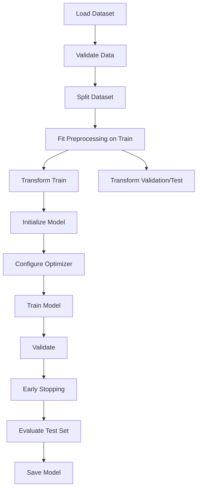

# **Phase 7 — Logistic Regression & Classification**

Phase 7 is where CML moves from predicting continuous numbers to **predicting categories**.

In Phase 5, you built Linear Regression to predict values such as prices. In Phase 6, you implemented optimization techniques to train models iteratively.

Examples:

| Input                    | Prediction             |
| ------------------------ | ---------------------- |
| Email content            | Spam / Not spam        |
| Transaction data         | Fraud / Legitimate     |
| Medical measurements     | Positive / Negative    |
| Customer data            | Churn / Retain         |
| Trading features         | Bullish / Bearish      |
| Iris flower measurements | Species classification |

Our first objective is **Binary Logistic Regression**, followed by multi-class classification.

# **Phase 7 objectives**

By the end of this phase, CML should support:

- Binary classification
- Logistic regression model architecture
- Sigmoid activation
- Probability prediction
- Class prediction
- Binary cross-entropy loss
- Analytical gradients
- Training using Phase 6 optimizers
- Decision thresholds
- Classification metrics
- Confusion matrix
- Precision, recall, F1
- ROC and AUC
- Regularization
- Multi-class classification
- One-vs-rest classification
- Softmax classification
- Model persistence
- End-to-end classification pipelines

# **Milestone 1 — Classification Foundation**

## **Assignment 01: Classification data representation**

Before implementing the model, establish how CML represents classification targets.

Binary targets:

$ y\in\\{0,1\\} $

Example:

```
0 = Not spam
1 = Spam
```

Dataset:

$ X= \begin{bmatrix} 1.2\\\ 2.4\\\ 3.1\\\ 4.5\\\ 5.7 \end{bmatrix} $

$ y= \begin{bmatrix} 0\\\ 0\\\ 0\\\ 1\\\ 1 \end{bmatrix} $

### **Requirements**

Define how your classification module handles:

- Binary labels
- Label validation
- Integer vs floating-point labels
- Invalid labels
- Empty datasets
- Missing values
- Feature dimensions
- Class imbalance

### **Design questions**

1. Will you represent labels using `CMLVector`?
2. Should labels be stored as doubles or integers?
3. Will you enforce labels strictly as `0` and `1`?
4. How should your API handle labels such as `-1` and `1`?
5. Should classification-specific data validation live in `dataset.c` or `classification.c`?

**Recommendation:** Initially use your existing `CMLVector` for targets and strictly validate that binary labels are `0.0` or `1.0`. Keep support for other label encodings as a later preprocessing feature.

# **Milestone 2 — Sigmoid Function**

## **Assignment 02: Implement the sigmoid activation**

The logistic regression model transforms a linear prediction into a probability.

First calculate:

$ z=w^Tx+b $

Then apply the sigmoid:

$ \sigma(z)=\frac{1}{1+e^{-z}} $

The result lies between 0 and 1.

### **Sigmoid visualization**


$ \sigma(z)=\frac{1}{1+e^{-z}} $

Interpretation:

| z   | Probability |
| --- | ----------- |
| -10 | ≈ 0.000045  |
| -5  | ≈ 0.00669   |
| -2  | ≈ 0.1192    |
| -1  | ≈ 0.2689    |
| 0   | 0.5         |
| 1   | ≈ 0.7311    |
| 2   | ≈ 0.8808    |
| 5   | ≈ 0.9933    |
| 10  | ≈ 0.999955  |

### **Requirements**

Implement:

- Scalar sigmoid
- Vector sigmoid
- Matrix sigmoid (bonus)
- In-place operation
- Non-in-place operation
- Numerical stability
- NaN handling
- Infinity handling

### **Numerical stability**

The naive implementation can overflow for very large negative or positive values.

Investigate a stable implementation using conditional evaluation depending on the sign of \\(z\\).

Test:

- `z = 0`
- Very large positive values
- Very large negative values
- Small values
- NaN
- Positive infinity
- Negative infinity

Expected behavior should be documented.

# **Milestone 3 — Binary Logistic Regression Model**

## **Assignment 03: Model architecture**

Create your binary logistic regression model.

The model:

$ z=w_1x_1+w_2x_2+\cdots+w_nx_n+b $

$ \hat y=\sigma(z) $

Where:

- \\(w\\) = weights
- \\(x\\) = input features
- \\(b\\) = bias
- \\(\hat y\\) = predicted probability of class 1

For example:

$ \hat y=0.87 $

means the model estimates an 87% probability of the positive class.

### **Requirements**

Design a model structure containing:

- Weight vector
- Bias
- Feature count
- Model initialization state
- Trained state
- Optional regularization settings
- Optional training metadata

### **Lifecycle API**

Design functions for:

- Create
- Initialize
- Clone
- Reset
- Destroy
- Get weights
- Set weights
- Get bias
- Set bias
- Feature count
- Model validation

### **Ownership**

Document:

- Who owns the weight vector?
- Are weights copied or borrowed?
- What happens when the model is cloned?
- What happens when initialization fails?
- What happens when retraining fails?
- Can the model preserve previously trained parameters after a failed training attempt?

Use transactional behavior when practical: failed retraining shouldn't destroy a previously valid trained model.

# **Milestone 4 — Probability Prediction**

## **Assignment 04:&#x20;**`predict_proba`

Implement probability prediction.

Given an input vector:

$ x=[x_1,x_2,\ldots,x_n] $

Calculate:

$ z=w^Tx+b $

Then:

$ P(y=1\mid x)=\sigma(z) $

And:

$ P(y=0\mid x)=1-\sigma(z) $

### **Requirements**

Implement:

- Single-sample probability prediction
- Batch probability prediction
- Feature count validation
- Trained-state validation
- Numerical stability
- Output allocation policies
- Error handling
- No mutation of input data

### **Test**

Create a model with:

$ w=2,\quad b=-4 $

For:

$ x=2 $

Calculate manually:

$ z=2(2)-4=0 $

Therefore:

$ P(y=1)=0.5 $

For:

$ x=3 $

$ z=2(3)-4=2 $

$ P(y=1)\approx0.880797 $

For:

$ x=1 $

$ z=2(1)-4=-2 $

$ P(y=1)\approx0.119203 $

Verify your implementation.

# **Milestone 5 — Decision Thresholds**

## **Assignment 05:&#x20;**`predict`

Probability prediction and class prediction are different operations.

Probability:

$ P(y=1\mid x)=0.73 $

Classification using threshold \\(t=0.5\\):

$ \hat{y} = \begin{cases} 1 & p \geq t \\ 0 & p < t \end{cases} $

### **Requirements**

Implement:

- Default threshold of 0.5
- Configurable threshold
- Single prediction
- Batch predictions
- Threshold validation
- Probability-to-class conversion
- Optional threshold configuration in model or prediction parameters

### **Experiments**

Test:

| Probability | Threshold | Predicted class |
| ----------- | --------- | --------------- |
| 0.49        | 0.5       | 0               |
| 0.50        | 0.5       | 1               |
| 0.51        | 0.5       | 1               |
| 0.80        | 0.9       | 0               |
| 0.80        | 0.7       | 1               |
| 0.30        | 0.2       | 1               |

Document your boundary behavior when the probability equals the threshold.

# **Milestone 6 — Binary Cross-Entropy Loss**

## **Assignment 06: Classification loss**

For logistic regression, we generally use Binary Cross-Entropy (BCE).

$ J(w,b)= -\frac{1}{m}\sum\_{i=1}^{m} \left[ y_i\log(\hat y_i) +(1-y_i)\log(1-\hat y_i) \right] $

This loss penalizes incorrect confident predictions heavily.

### **Example**

Actual:

$ y=1 $

Predicted probability:

$ \hat y=0.9 $

Loss:

$ -\log(0.9)\approx0.10536 $

If the model predicts:

$ \hat y=0.1 $

Loss:

$ -\log(0.1)\approx2.30259 $

The second prediction is significantly worse.

### **Requirements**

Implement:

- Binary cross-entropy
- Per-sample BCE
- Mean BCE
- Batch BCE
- Optional weighted BCE
- Input validation
- Numerical stability

### **Critical numerical issue**

What happens when:

$ \hat y=0 $

or

$ \hat y=1 $

The logarithm can become undefined or infinite.

Investigate probability clipping:

$ \hat y\_{\text{safe}}= \min(1-\epsilon,\max(\epsilon,\hat y)) $

Use a configurable or carefully selected numerical epsilon.

**Bonus:** Implement BCE directly from logits rather than calculating sigmoid first. This is more numerically stable for extreme values.

# **Milestone 7 — Analytical Gradients**

## **Assignment 07: Derive the logistic regression gradients**

This is the mathematical heart of logistic regression training.

For one sample:

$ z=w^Tx+b $

$ p=\sigma(z) $

The binary cross-entropy loss:

$ L=-[y\log(p)+(1-y)\log(1-p)] $

The combined derivative simplifies beautifully:

$ \frac{\partial L}{\partial z}=p-y $

Therefore:

### **Weight gradients**

$ \frac{\partial J}{\partial w_j} = \frac{1}{m} \sum\_{i=1}^{m}(p_i-y_i)x\_{ij} $

### **Bias gradient**

$ \frac{\partial J}{\partial b} = \frac{1}{m} \sum\_{i=1}^{m}(p_i-y_i) $

### **Vector form**

$ \nabla_wJ=\frac{1}{m}X^T(p-y) $

This is computationally efficient because you don't need to separately calculate the sigmoid derivative during the combined BCE gradient derivation.

### **Requirements**

Implement:

- Single-sample gradient
- Batch gradient
- Weight gradient vector
- Bias gradient
- Gradient norm
- Multiple-feature gradients
- Finite-value validation

### **Test dataset**

$ X= \begin{bmatrix} 1\\\ 2\\\ 3 \end{bmatrix} $

$ y= \begin{bmatrix} 0\\\ 0\\\ 1 \end{bmatrix} $

Initial parameters:

$ w=0,\quad b=0 $

Every sample has probability:

$ p=0.5 $

Calculate the gradients manually.

Expected bias gradient:

$ \frac{(0.5-0)+(0.5-0)+(0.5-1)}{3} =\frac{0.5}{3} \approx0.166667 $

Expected weight gradient:

$ \frac{(0.5-0)(1)+(0.5-0)(2)+(0.5-1)(3)}{3} $

$ =\frac{0.5+1-1.5}{3}=0 $

Your implementation should reproduce these results.

# **Milestone 8 — Training with Gradient Descent**

## **Assignment 08: Train Logistic Regression**

Now connect your Phase 6 optimizer to your Phase 7 model.

The model parameters:

$ \theta=[w_1,w_2,\ldots,w_n,b] $

The optimizer minimizes binary cross-entropy.

### **Requirements**

Implement:

- Model initialization
- Training dataset validation
- Gradient calculation
- Batch GD
- SGD
- Mini-batch GD
- Momentum (reuse Phase 6)
- Configurable learning rate
- Epochs
- Convergence
- Training history
- Training status

### **Dataset**

Use a simple linearly separable dataset:

| X   | Y   |
| --- | --- |
| 1   | 0   |
| 2   | 0   |
| 3   | 0   |
| 7   | 1   |
| 8   | 1   |
| 9   | 1   |

Expected behavior:

- Lower inputs should receive probabilities closer to 0.
- Higher inputs should receive probabilities closer to 1.
- BCE should decrease during training.
- The decision boundary should lie between the two classes.

### **Important distinction**

Logistic regression doesn't require your model to output exactly 0 or 1.

It outputs probabilities.

Your model should learn to make the probability distributions increasingly confident when the data supports it.

# **Milestone 9 — Classification Evaluation**

Regression metrics aren't sufficient for classification. We need classification-specific evaluation tools.

## **Assignment 09: Confusion Matrix**

Build a confusion matrix.

## **Confusion matrix**

Rows = actual class · Columns = predicted class

|          | Predicted 0 | Predicted 1 |
| -------- | ----------- | ----------- |
| Actual 0 | **TN**      | **FP**      |
| Actual 1 | **FN**      | **TP**      |

Definitions:

- TP = True Positive
- TN = True Negative
- FP = False Positive
- FN = False Negative

### **Requirements**

Implement:

- Confusion matrix
- Counts
- Matrix initialization
- Prediction and actual label validation
- Batch evaluation
- Class ordering
- Matrix reporting

### **Test**

Actual:

$ y=[1,1,1,0,0,0] $

Predicted:

$ \hat y=[1,1,0,1,0,0] $

Expected:

- TP = 2
- TN = 2
- FP = 1
- FN = 1

# **Assignment 10 — Classification Metrics**

Implement the following metrics.

## **Accuracy**

$ Accuracy=\frac{TP+TN}{TP+TN+FP+FN} $

## **Precision**

$ Precision=\frac{TP}{TP+FP} $

Precision answers:

> When the model predicts positive, how often is it correct?

## **Recall**

$ Recall=\frac{TP}{TP+FN} $

Recall answers:

> How many of the actual positive samples did the model detect?

## **F1 score**

$ F1=2\frac{Precision\cdot Recall}{Precision+Recall} $

## **Specificity**

$ Specificity=\frac{TN}{TN+FP} $

## **Balanced accuracy**

$ BalancedAccuracy=\frac{Sensitivity+Specificity}{2} $

### **Requirements**

Implement:

- Accuracy
- Precision
- Recall
- F1
- Specificity
- Balanced accuracy
- Sensitivity
- Error rate
- Per-class metrics where appropriate

### **Edge cases**

Consider:

- No positive predictions
- No actual positive samples
- Empty dataset
- Zero denominators
- Invalid labels
- Perfect predictions

For undefined metrics, establish a consistent policy, such as returning an error, NaN, or a configurable zero-division value.

Document your policy.

# **Milestone 10 — Threshold Optimization & Imbalanced Data**

## **Assignment 11: Configurable decision thresholds**

The default threshold of 0.5 isn't always optimal.

For example, fraud detection may prioritize recall to catch as many fraudulent transactions as possible.

A high threshold:

- Fewer positive predictions
- Usually higher precision
- Usually lower recall

A low threshold:

- More positive predictions
- Usually higher recall
- May lower precision

### **Requirements**

Implement:

- Threshold configuration
- Threshold sweep
- Metric calculation for each threshold
- Best threshold selection
- Precision-recall tradeoff
- F1-based threshold optimization

Test thresholds from:

$ 0.05,\ 0.10,\ 0.15,\ldots,0.95 $

For every threshold, calculate:

- Accuracy
- Precision
- Recall
- F1
- Specificity

Create a report or dataset showing the relationship between threshold and classification performance.

## **Assignment 12: Class imbalance handling**

Consider this dataset:

- 9,900 legitimate transactions
- 100 fraudulent transactions

A model that predicts every transaction as legitimate achieves:

$ Accuracy=99\\% $

Yet it detects zero fraud.

This is why accuracy alone can be misleading.

### **Requirements**

Implement or investigate:

- Class distribution analysis
- Class weights
- Weighted BCE
- Oversampling
- Undersampling
- Stratified splitting
- Balanced accuracy

### **Weighted loss**

$ J=-\frac{1}{m}\sum\_{i=1}^{m} \left[ w_1y_i\log(p_i)+ w_0(1-y_i)\log(1-p_i) \right] $

Where \\(w_0\\) and \\(w_1\\) represent class weights.

Implement configurable class weights.

Investigate how class weighting affects:

- Gradient calculations
- Loss
- Precision
- Recall
- Decision boundary

# **Milestone 11 — ROC & AUC**

## **Assignment 13: ROC curve**

The Receiver Operating Characteristic (ROC) curve evaluates classification performance across multiple thresholds.

It plots:

$ TPR=\frac{TP}{TP+FN} $

Against:

$ FPR=\frac{FP}{FP+TN} $

Where:

- TPR = True Positive Rate (Recall)
- FPR = False Positive Rate

### **Requirements**

Implement:

- ROC data generation
- Threshold enumeration
- TPR calculation
- FPR calculation
- ROC points
- ROC-AUC

### **AUC interpretation**

| AUC       | Interpretation                   |
| --------- | -------------------------------- |
| 1.0       | Perfect classification           |
| 0.9–1.0   | Excellent                        |
| 0.8–0.9   | Good                             |
| 0.7–0.8   | Fair                             |
| 0.5       | Random-like                      |
| Below 0.5 | Potentially inverted predictions |

These ranges are only rough interpretations, not universal standards.

### **Requirements for AUC**

Use a numerical integration technique such as trapezoidal integration.

Your implementation must:

- Handle ties in predicted probabilities
- Correctly order ROC points
- Handle datasets containing only one class
- Validate probability inputs

**Bonus:** Implement the rank-based AUC calculation and compare it against your ROC integration.

# **Milestone 12 — Regularization**

## **Assignment 14: L1 & L2 regularization**

Regularization helps prevent overfitting and can discourage excessively large model weights.

### **L2 regularization**

$ J\_{\text{regularized}} = J\_{\text{BCE}}+\frac{\lambda}{2m}\sum\_{j=1}^{n}w_j^2 $

Gradient:

$ \frac{\partial J}{\partial w_j} = \frac{1}{m}\sum\_{i=1}^{m}(p_i-y_i)x\_{ij} +\frac{\lambda}{m}w_j $

Bias generally isn't regularized.

### **L1 regularization**

$ J\_{\text{regularized}} = J\_{\text{BCE}}+\frac{\lambda}{m}\sum\_{j=1}^{n}|w_j| $

The gradient contribution is based on the sign of each weight, with special consideration for zero.

### **Requirements**

Implement:

- No regularization
- L1
- L2
- Configurable lambda
- Weight-only regularization
- Loss reporting
- Regularized gradient
- Model configuration

### **Experiments**

Train models using:

$ \lambda=0,\ 0.001,\ 0.01,\ 0.1,\ 1.0 $

Compare:

- Training loss
- Validation loss
- Weight magnitudes
- Performance
- Overfitting

# **Milestone 13 — Multi-Class Classification**

After binary classification works, extend CML to handle more than two classes.

Example:

[Logistic Regression in Machine Learning: A mathematical guide — Part 2 | by Chamuditha Kekulawala | Medium](https://images.openai.com/static-rsc-4/vn1CL9yWWqpakRGeZcLlAql5X0HmpGW8yKdUIOEhfq_V32fxb1UkadEI79PUVpKaNUNy8OfgAbtq65vI0LV_gPmghO8S3osoM2S2h-L-RuHONU0SiS-urx9HVCB6EGwKOATI5kJ_iQ0g4oOrv5AHuZtrbs2pmLbJtz0cdFhRoXc?purpose=inline)

[Principles and Techniques of Data Science - 24  Decision Trees](https://images.openai.com/static-rsc-4/tz8XO6JUXLYbYRI66t2nXzFVFCwQHTIJJKpeBg6-QpXLTrsexG41_8sBWNUseV2cDNYIDcC0efZ4SBu1VZq-FBSkmgRNU9u7Ye1mLgy-sQ-FP4GKFz1cP5QqMIdcO6NHyBOCTyEgISWIdb_6vHzR7HQL3kHVZ9g0jH9ByJ0-2W4?purpose=inline)

[Fronteras de decisión para tres clases | Interactive Chaos](https://images.openai.com/static-rsc-4/wiqCt7TBKsdn-tQKumsYxdJRLz6He_q4_PYQWi3q0mNogcUTnM_tqqVkzf4Pi_zrdZbUrI5TN1JAx_wZsroYb3A0shnTRgfpfij6QBaVAGwoZMR78rY8nLePTWvVV1VUvZVPYGVx4K9r-NGh829ujj-zoPpuLtvWldZL-rbamiQ?purpose=inline)

6

Classes:

- 0 — Setosa
- 1 — Versicolor
- 2 — Virginica

## **Assignment 15: One-vs-Rest (OvR)**

Train one binary classifier for each class.

For 3 classes:

- Classifier 1: Class 1 vs everything else
- Classifier 2: Class 2 vs everything else
- Classifier 3: Class 3 vs everything else

### **Requirements**

Implement:

- Multi-class model architecture
- Number of classes
- Multiple binary models
- Probability prediction
- Class prediction
- Model lifecycle
- Training
- Evaluation

### **Prediction**

For each class:

$ p_k=P(y=k\mid x) $

Select the class with the highest predicted probability:

$ \hat y=\arg\max_k p_k $

Investigate whether OvR probabilities sum to 1.0. They generally aren't guaranteed to, so document how your implementation handles that.

# **Milestone 14 — Softmax Regression**

## **Assignment 16: Multinomial Logistic Regression**

Implement Softmax regression as an alternative to OvR.

For each class:

$ z_k=w_k^Tx+b_k $

Softmax:

$ P(y=k\mid x)= \frac{e^{z_k}}{\sum\_{j=1}^{K}e^{z_j}} $

This converts class scores into a probability distribution.

$ \sum\_{k=1}^{K}P(y=k\mid x)=1 $

## **Requirements**

Implement:

- Softmax function
- Numerically stable Softmax
- Multinomial model
- Weight matrix
- Bias vector
- Probability prediction
- Class prediction
- Multi-class cross-entropy
- Analytical gradients
- Training
- Regularization

### **Numerical stability**

For large logits, calculate Softmax using a stable transformation:

$ P(y=k\mid x) = \frac{e^{z_k-z\_{\max}}} {\sum_j e^{z_j-z\_{\max}}} $

Where:

$ z\_{\max}=\max(z_1,z_2,\ldots,z_K) $

This avoids exponential overflow.

### **Gradient**

For one-hot labels:

$ \frac{\partial J}{\partial w_k} = \frac{1}{m}\sum\_{i=1}^{m} (p\_{ik}-y\_{ik})x_i $

$ \frac{\partial J}{\partial b_k} = \frac{1}{m}\sum\_{i=1}^{m}(p\_{ik}-y\_{ik}) $

# **Milestone 15 — Multi-Class Metrics**

## **Assignment 17**

Extend your evaluation module to multi-class classification.

Implement:

- Multi-class confusion matrix
- Per-class precision
- Per-class recall
- Per-class F1
- Macro average
- Micro average
- Weighted average
- Accuracy
- Balanced accuracy

### **Macro averaging**

Calculate metrics independently for each class, then average equally.

$ F1\_{\text{macro}}=\frac{1}{K}\sum\_{k=1}^{K}F1_k $

### **Weighted averaging**

Weight each class's metric by its sample count.

$ F1\_{\text{weighted}} = \frac{\sum_k n_kF1_k}{\sum_k n_k} $

### **Micro averaging**

Aggregate the total TP, FP, and FN across all classes before calculating the metrics.

Test all metrics against manually calculated datasets.

# **Milestone 16 — Classification Pipeline**

## **Assignment 18**

Build an integrated classification pipeline.

The pipeline should combine:

- Dataset
- Preprocessing
- Feature scaling
- Feature selection (optional)
- Model
- Optimizer
- Loss
- Evaluation
- Model persistence

### **Pipeline workflow**



### **Requirements**

Implement an end-to-end pipeline that is reproducible and correctly avoids data leakage.

# **Milestone 17 — Model Persistence & Deployment**

## **Assignment 19**

Your trained classifier should be saveable and reloadable.

Store:

- Model type
- Version
- Weights
- Bias
- Feature count
- Number of classes
- Classification threshold
- Regularization settings
- Class labels
- Model metadata

### **Requirements**

Implement:

- Save model
- Load model
- Format validation
- Version compatibility
- Corrupt file detection
- Feature count validation
- Prediction consistency

### **Test**

1. Train a model.
2. Generate predictions for 100 samples.
3. Save the model.
4. Destroy it.
5. Load the saved model.
6. Generate predictions again.
7. Compare all predictions.

Predictions before and after loading should match within your numerical tolerance.

# **Milestone 18 — Capstone Project**

## **Build a complete classification application**

Choose one dataset.

Suggested projects:


**Project A — Fraud Detection**

Binary classification. Focus on class imbalance, recall, precision, and threshold optimization.


**Project B — Spam Detection**

Binary classification. Focus on BCE, feature processing, probabilities, and thresholds.


**Project C — Iris Classification**

Multi-class classification. Compare OvR against Softmax.


**Project D — Market Direction Classifier**

Use historical features to predict the next candle's direction. Focus on temporal leakage, train/test chronology, and classification metrics.

Since you've already been exploring candle data and trading systems, Project D is a particularly useful eventual application of CML. Make sure you use chronological train/validation/test splits rather than random shuffling for time-series data, and don't let future information leak into the features.

### **Capstone deliverables**

Your application must:

1. Load a dataset.
2. Validate the data.
3. Identify classes.
4. Analyze class distribution.
5. Handle missing values.
6. Split into train, validation, and test.
7. Fit preprocessing on training data only.
8. Train logistic regression.
9. Tune hyperparameters.
10. Optimize the decision threshold.
11. Evaluate classification performance.
12. Print confusion matrix.
13. Print classification metrics.
14. Report ROC-AUC when applicable.
15. Compare regularization strategies.
16. Save the model.
17. Reload and verify predictions.
18. Provide a clear example of using the trained model for inference.

# **Phase 7 grading rubric**

| Category                              | Points  |
| ------------------------------------- | ------- |
| Data & label validation               | 5       |
| Sigmoid numerical stability           | 10      |
| Model architecture                    | 10      |
| Probability & class prediction        | 10      |
| Binary cross-entropy                  | 10      |
| Analytical gradients                  | 10      |
| Training & optimizer integration      | 10      |
| Classification metrics                | 10      |
| Threshold optimization                | 5       |
| Regularization                        | 5       |
| Multi-class classification            | 10      |
| Testing, documentation & architecture | 5       |
| **Total**                             | **100** |

### **Bonus challenges**

- Weighted BCE
- ROC-AUC
- Gradient checking
- Early stopping
- L1/L2 regularization
- Softmax
- Feature selection
- Model persistence
- Multiclass calibration
- Cross-validation
- Learning curves
- Class imbalance handling

# **Recommended execution order**

1. **M1:** Data representation & validation
2. **M2:** Sigmoid & numerical stability
3. **M3:** Model architecture
4. **M4:** Probability prediction
5. **M5:** Classification thresholds
6. **M6:** Binary cross-entropy
7. **M7:** Analytical gradients
8. **M8:** Training & optimizer integration
9. **M9:** Confusion matrix
10. **M10:** Classification metrics
11. **M11:** Threshold optimization & imbalance
12. **M12:** ROC & AUC
13. **M13:** Regularization
14. **M14:** One-vs-Rest
15. **M15:** Softmax regression
16. **M16:** Multi-class metrics
17. **M17:** Classification pipeline
18. **M18:** Model persistence
19. **M19:** Capstone

## **Your first assignment**

Begin with **Milestone 1 and Milestone 2**.

Submit these files/designs for review:

- `classification.h`
- `activation.h` (or your proposed sigmoid API)
- Proposed logistic regression model structure
- Label representation strategy
- Sigmoid test cases
- Numerical stability strategy
- Error handling conventions

Don't implement the entire classifier at once. We'll review your API first, then implement and test the sigmoid, followed by the model.

## **Your CML roadmap after Phase 7**

| Phase | Subject                                                   |
| ----- | --------------------------------------------------------- |
| 0     | C fundamentals & infrastructure                           |
| 1     | Numerical foundation                                      |
| 2     | Vector engine                                             |
| 3     | Matrix engine                                             |
| 4     | Statistics & data processing                              |
| 5     | Linear regression                                         |
| 6     | Gradient descent & optimization                           |
| **7** | **Logistic regression & classification**                  |
| 8     | Neural networks & forward propagation                     |
| 9     | Backpropagation & gradient checking                       |
| 10    | Advanced optimizers                                       |
| 11    | Metrics, model management & serialization                 |
| 12    | Advanced algorithms, performance & production engineering |

Phase 7 is a major milestone: after completing it, you'll have implemented a complete supervised-learning workflow for both regression and classification **without relying on a machine-learning framework**.

And importantly, your Phase 6 optimizer, matrix engine, preprocessing utilities, and statistics module will now work together as real components of a machine-learning system.
